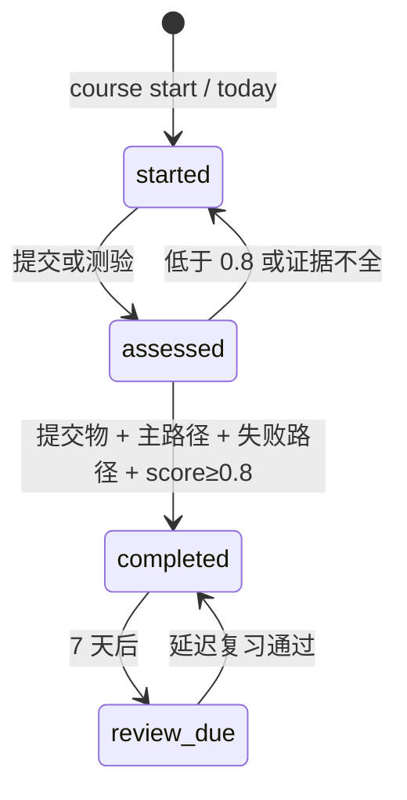

# 如何用好推荐系统学习 Agent

本指南面向 Claude Code、Codex 等仓库 Agent 用户。目标不是让 Agent 替你总结 PDF，而是让它管理“阅读证据 → 推导 → 实践 → 验收 → 反馈 → 复习”的闭环。

## 1. 先建立可复核的知识源

```bash
python3 tools/recsys_agent.py index
python3 tools/recsys_agent.py doctor
python3 tools/recsys_agent.py eval
```

`doctor` 必须显示 `index=ready`。PDF 是权威正文；`knowledge/` 仅负责导航；`.recsys-agent/` 是可删除的本地提取缓存。向 Agent 提问时要求它区分：

- `本书依据`：发布 PDF 的章节和 PDF 页码；
- `扩展说明`：不在本书中的经验、论文或推断；
- `[MOCK]`：教学模板中的替代依赖，不得声称可直接上线。

推荐提示词：

```text
先检索发布 PDF，再回答。给出 PDF 文件和 PDF 页码；
把本书依据与扩展说明分开；不确定时说明边界，不要补写书中没有的内容。
```

## 2. 选择完整课程

```bash
python3 tools/recsys_agent.py course list
python3 tools/recsys_agent.py course start new-engineer  # 校招入职/初级工程师
# 或
python3 tools/recsys_agent.py course start graduate      # 研究生
```

两门课程各 12 个单元，覆盖 19 个已发布章节。人读入口是 `learning-paths/*.md`；机器可读课程在 `learning-paths/courses.json`。课程单元包含章节、概念、指定阅读、实践命令、提交物、验收条件和检索/应用题。

## 3. 每次只生成一个可完成任务

```bash
python3 tools/recsys_agent.py course today --minutes 90
```

输出按主题特征分配阅读、推导、实践和验收时间。实践型主题会给实践更多时间；实验设计型主题会给推导更多时间。不要让 Agent 一次生成整周长文；让它依次做：

1. 根据 `reading` 打开 PDF 指定页，提取问题相关证据；
2. 回答 `questions`，先独立作答再让 Agent 纠错；
3. 运行 `practice` 主路径，保存命令、退出码和关键输出；
4. 修改参数或注入故障，运行失败路径；
5. 按 `acceptance` 检查提交物。

可直接给 Agent：

```text
执行 course today 给出的当前单元。先让我回答问题，不要直接泄露答案；
然后检查我的推理。实践必须真实运行主路径和失败路径，把命令、输出、原因、恢复条件写进提交物。
```

## 4. 提交真实证据，而不是口头“学完了”

建议提交物模板：

```markdown
# 单元 ID
## 本书依据
- PDF 文件、PDF 页码、支持的结论
## 我的解释
- 核心机制、目标、取舍和适用边界
## 实践
- 环境与版本
- 主路径命令、退出码、关键输出
- 失败路径命令、退出码、原因、恢复条件
## 问题答案
- 逐题回答
## 仍不确定
- 概念或工程约束
```

提交：

```bash
python3 tools/recsys_agent.py course submit \
  --course new-engineer --unit ne-01 \
  --evidence /tmp/ne-01.md --score 0.85 \
  --practice-passed --failure-path
```

状态语义：



`--practice-passed` 和 `--failure-path` 是学习者声明；提交物应保留可复核输出。Agent 必须读取提交物并按单元 `acceptance` 评分，不能仅因文件存在就给高分。

## 5. 随时反馈，下一次再调整

```bash
python3 tools/recsys_agent.py course feedback \
  --message "负采样偏差仍不清楚；本周只有 45 分钟；希望增加手算例子"
python3 tools/recsys_agent.py course today --minutes 45
```

反馈应写具体事实：可用时间、卡住的问题、实践输出、错误理解、资源约束。不要只写“太难”。Agent 下一轮应：

- 保留当前单元，不因时间不足跳过验收；
- 针对低分题安排重读和小实验；
- 已掌握部分减少重复；
- 只推荐前置已满足的下一主题。

查看状态和下一主题：

```bash
python3 tools/recsys_agent.py course status
python3 tools/recsys_agent.py next
python3 tools/recsys_agent.py graph --course new-engineer --output /tmp/new-engineer.mmd
```

个人记录只写入被 Git 忽略的 `.recsys-workspace/progress.jsonl`，不得提交真实公司数据、用户信息或内部事故详情。

## 6. 做延迟复习和迁移测试

完成单元 7 天后：

```bash
python3 tools/recsys_agent.py course review
```

复习不再重复原答案，而是完成四类任务：

1. 不看资料解释核心机制；
2. 找出一个错误设计；
3. 修改一个参数并预测结果；
4. 迁移到新业务场景并说明取舍。

这用于区分短期记忆与真正掌握。复习失败时，把反馈写入 `course feedback`，重做对应单元证据。

## 7. 生成自己的可复核报告

```bash
python3 tools/recsys_agent.py self-eval \
  --output .recsys-workspace/self-eval.json
```

报告包含固定检索集 Recall@5、引用有效率、已完成记录和到期复习数。它不等于教学效果证明；课程完成率、首次成功时间、一周后保持率和迁移任务仍需真实学习者数据。

若要评价仓库新版 Agent 是否优于旧版，按 `evals/usability.md` 做冻结 revision、相同模型/提示词、独立会话和盲评，不使用当前学习记录替代 A/B 证据。

## 8. 何时使用自由主题模式

课程外临时学习一个主题：

```bash
python3 tools/recsys_agent.py learn "HNSW" --level graduate --minutes 120
```

完成时仍需要证据：

```bash
python3 tools/recsys_agent.py complete hnsw \
  --evidence /tmp/hnsw.md --score 0.9 \
  --practice-passed --failure-path
```

自由模式适合补缺，不替代完整课程。若前置概念不满足，先运行 `next` 或回到课程当前单元。

## 9. Agent 的边界

Agent 可以检索、拆任务、检查结构化验收条件、运行仓库模板和记录反馈；它不能仅凭一份文件可靠判断你是否真正理解，也不能替代生产数据、线上实验、隐私审查和容量压测。对生产工程问题，必须补齐目标、QPS、P99、规模、新鲜度、一致性、运行时、部署、可用性、隐私和成本约束。
